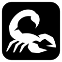

<div align="center">



# Yaare

**Build with ❤️** | [公式サイト](https://yaare.app) · [Discord](https://discord.gg/pcpfXrGcA4) · [GitHub](https://github.com/plumbral/yaare)

</div>

Yaare は [MyGo](https://github.com/egoist/mygo) で開発した、Windows、macOS、Linux 対応の SSH クライアントです。ターミナルをタブや分割ペインで開き、同じ画面で SFTP によるファイル転送やリモートファイルの編集ができます。設定は暗号化して端末間で同期できます。Docker でセルフホストすれば、ブラウザからも利用できます。

[English](README.md) · [简体中文](README.zh-Hans.md) · [繁體中文](README.zh-Hant.md) · **日本語**

## 特長

- **軽量なデスクトップアプリ**　Go のバックエンドと OS 標準の WebView を使う [MyGo](https://github.com/egoist/mygo) を採用し、配布サイズとメモリ使用量を抑えています。
- **設定は手元で管理**　アカウント登録は不要で、利用状況を収集するテレメトリもありません。保存したパスワードとアプリで管理する秘密鍵は、デスクトップ版では OS の認証情報ストア、Docker 版では別のボリュームに保管したインスタンス鍵で暗号化します。データファイルを読める人は、ホストのアドレス、ユーザー名、メモ、保存したコマンド、手動で記録した端末の出力も読めます。同期を有効にすると、指定した Yaare サーバー、WebDAV、S3 に設定をエンドツーエンド暗号化して送ります。
- **SSH 接続に必要なツールをひとつの画面に**　ターミナルから SFTP、リモートファイルの編集、ディレクトリの比較・同期、ポート転送、リモートデスクトップまで、同じワークスペースで操作できます。

## 主な機能

| 分野 | 機能 |
| --- | --- |
| **ターミナルとセッション** | タブと分割ペイン、ワークスペースの復元、自動再接続、複数ペインへのコマンド一斉送信、クイックコマンド、セッションログ、`rz` と `sz` を使った ZMODEM 転送 |
| **接続とネットワーク** | ホストのグループ化と一括編集、`~/.ssh/config` のインポート、複数ホストで共用できる認証情報、秘密鍵の管理、ユーザー証明書と FIDO2 に対応した SSH エージェント、多段の踏み台ホスト、HTTP / SOCKS5 プロキシ、ローカルとリモートのポート転送、SOCKS5 による動的ポート転送 |
| **ファイル転送と編集** | SFTP でのファイル閲覧とドラッグ＆ドロップ転送、中断した転送を再開できるキュー、SCP、競合の検出と差分表示に対応したリモートテキストエディター、ローカルとリモートのディレクトリを左右に並べて比較・双方向同期 |
| **リモートデスクトップ** | 全画面表示と読み取り専用モードに対応した内蔵 VNC クライアント、SSH の X11 転送、Windows リモートデスクトップを使った SSH トンネル経由の RDP 接続 |
| **同期とバックアップ** | セルフホストの Yaare サーバー、WebDAV、S3 を使ったエンドツーエンド暗号化同期、過去のバージョンへの復元、OS をまたいで移行できる`.yaare` 形式の暗号化バックアップ |
| **セルフホストとカスタマイズ** | シングルユーザー向け Docker ブラウザ版での SSH・SFTP・VNC 接続とデスクトップ版との設定同期、ライト・ダークテーマとターミナル配色、ショートカットの変更、日本語・英語・簡体字中国語・繁体字中国語の UI |

## 今後の予定

- [ ] **AI によるターミナル操作の支援**　ターミナルでの作業内容に応じたコマンド生成、エラーの原因調査、ログ分析。
- [ ] **AI による運用の自動化**　複数の手順にまたがる障害調査や設定変更、日常の運用作業を AI が計画し、ユーザーが承認した範囲で実行。
- [ ] **iOS と Android 向けのモバイルアプリ**

## ダウンロードとインストール

[GitHub Releases](https://github.com/plumbral/yaare/releases) で、対象バージョンの **Assets** からお使いの環境に合うファイルをダウンロードしてください。

- **Windows**　x64 の場合は `amd64`、Arm の場合は `arm64` の `.exe` インストーラーを実行します。
- **macOS**　macOS 13.3 以降に対応しています。Apple シリコンと Intel 共通の `.dmg` を開き、**Yaare** を「アプリケーション」フォルダにドラッグします。コピーが終わったらディスクイメージを取り出してください。
- **Linux**　x86-64 と ARM64 用の `.deb` および `.rpm` を用意しています。ユーザー単位でインストールするには、同じリリースの `install.sh` と対象アーキテクチャの `.tar.gz` を同じディレクトリに置き、`sh install.sh` を実行します。

> 開発とテストは主に Windows と Linux で行っています。macOS の実機での検証は限られているため、不具合の報告を歓迎します。

各リリースに含まれる `SHA256SUMS` で、ダウンロードしたファイルのチェックサムを確認できます。

**Docker でセルフホストする場合**　リリースに添付された `compose.yaml` を空のディレクトリに保存します。そのディレクトリで `docker compose run --rm yaare init` を実行して管理者パスワードを設定し、`docker compose up -d` で起動します。ブラウザで `http://127.0.0.1:4180` を開き、ユーザー名 `admin` でログインしてください。[中国語の Docker デプロイガイド](deployment/docker/README.md)

## ドキュメント

以下のガイドは中国語で書かれています。

- [セルフホストの Yaare サーバー、WebDAV、S3 を使った設定の同期とバックアップ](docs/Sync_and_Backup.md)
- [ローカルの暗号化バックアップと移行](docs/Local_Encrypted_Config.md)
- [macOS デスクトップ版ガイド](docs/macOS_Desktop.md)
- [リリース手順](docs/releases/README.md)

## ソースから起動する

Go 1.27.3 以降と Bun 1.4.4 が必要です。OS ごとに次の環境も用意してください。

- **Windows**　Evergreen WebView2 ランタイムが必要です。
- **macOS**　ユニバーサル `.dmg` の作成手順は [macOS デスクトップ版ガイド](docs/macOS_Desktop.md)を参照してください。
- **Linux**　GTK 3 と WebKitGTK 4.1 の開発ライブラリが必要です。認証情報を保存するには、Secret Service のキーリングのロックを解除してください。

リポジトリのルートで次のコマンドを実行すると、デスクトップアプリが開発モードで起動します。

```sh
bun install --frozen-lockfile
bun run generate
bun run dev
```

| コマンド | 用途 |
| --- | --- |
| `bun run dev:web` | フロントエンドの開発用プレビューを `http://127.0.0.1:5173/` で起動 |
| `bun run typecheck` | TypeScript の型チェックを実行 |
| `bun run build` | 現在の OS 向けにデスクトップアプリをビルド |
| `bun run build:web` | デスクトップ版のフロントエンドをビルドし、MyGo に組み込むアセットを作成 |
| `bun run build:browser` | セルフホスト用ブラウザ版のフロントエンドをビルド |
| `.\scripts\check.ps1` | Windows でフロントエンドと Go のテスト、静的チェック、ビルドを実行 |

## ディレクトリ構成

- `cmd/yaare` と `cmd/yaare-web` は、それぞれデスクトップアプリとセルフホスト用サーバーのエントリーポイントです。
- `internal/` には Go のバックエンドがあります。[英語のバックエンド構成ガイド](internal/README.md)
- `frontend/src/` には React で実装したワークスペースの UI があります。
- `locales/` には英語、日本語、簡体字中国語、繁体字中国語の UI 翻訳が入っています。
- `scripts/`、`tools/`、`tests/` にはビルドスクリプト、アセットの生成ツール、回帰テストがあります。[中国語のテストガイド](tests/README.md)

バックエンドのインターフェースや翻訳を変更したら `bun run generate` を、配色を変更したら `bun run theme:generate` を実行してください。

## ライセンス

Yaare のデスクトップクライアント、ブラウザクライアント、セルフホスト用 Docker サービスのコードには、GNU Affero General Public License v3.0 を適用しています。ライセンス識別子は `AGPL-3.0-only` です。サードパーティ製のコードと素材にはそれぞれのライセンスが適用されます。[プロジェクトのライセンス](LICENSE) · [サードパーティのライセンスと表記](resources/licenses/)
