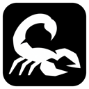

<div align="center">



# Yaare

[Website](https://yaare.app) · [Discord](https://discord.gg/pcpfXrGcA4) · [GitHub](https://github.com/plumbral/yaare)

</div>

Yaare is a cross-platform SSH client built with [MyGo](https://github.com/egoist/mygo) for Windows, macOS, and Linux. It combines tabbed and split-pane terminals, SFTP file management, remote text editing, and encrypted configuration sync, and can also be self-hosted with Docker for browser access.

**English** · [简体中文](README.zh-Hans.md) · [繁體中文](README.zh-Hant.md) · [日本語](README.ja.md)

## Highlights

- **Lightweight desktop architecture**: Built with [MyGo](https://github.com/egoist/mygo) using a Go backend and the system WebView rather than bundling Electron, keeping binary size and memory footprint modest. Supports Windows, macOS, and Linux, alongside a self-hosted Docker web edition.
- **Local storage and privacy** — Yaare uses the `AGPL-3.0-only` license, requires no account and collects no telemetry. Desktop credentials are encrypted with the OS credential store. Docker uses an instance key kept in a separate volume. Host addresses, usernames, notes, saved commands and optional terminal recordings are readable by anyone with access to those files. Optional sync uses end-to-end encryption with your Yaare instance, WebDAV or S3.
- **Integrated SSH workbench**: Brings terminals, SFTP transfers, remote file editing, directory comparison and sync, port forwarding, and remote desktop together in a single workspace.

## Features

| Area | Capabilities |
| --- | --- |
| **Terminal & sessions** | Tabs and split panes, workspace state restore, auto-reconnect, multi-pane command broadcast, quick commands, session logs, ZMODEM transfers with `rz` and `sz` |
| **Connections & networking** | Host groups and batch editing, `~/.ssh/config` import, reusable identities and managed keys, SSH agent support for user certificates and FIDO2 keys, multi-hop jump hosts, HTTP / SOCKS5 proxies, local / remote / dynamic SOCKS5 port forwarding |
| **Files & editing** | SFTP browsing and drag-and-drop transfers, resumable transfer queue, SCP, a built-in remote text editor with conflict detection and a diff view, two-pane local/remote directory comparison and sync |
| **Remote desktop** | Built-in VNC client with fullscreen and read-only modes, SSH X11 forwarding, Windows RDP over an SSH tunnel |
| **Sync & backup** | End-to-end encrypted sync through self-hosted Yaare, WebDAV or S3, with version history and rollback. Encrypted `.yaare` backups work across platforms. |
| **Self-hosted & customization** | The single-user Docker web edition supports SSH, SFTP and VNC and syncs settings with the desktop app. Choose light or dark themes, terminal palettes, custom shortcuts and an interface in English, Japanese, Simplified Chinese or Traditional Chinese. |

## Roadmap

- [ ] **AI terminal assistance**: Context-aware command generation, error troubleshooting, and log analysis
- [ ] **AI-driven automation**: Plan and automate multi-step diagnostics, configuration, and routine server tasks within user-approved boundaries
- [ ] **Mobile apps for iOS and Android**

## Download

Download the installer for your platform from **Assets** on [GitHub Releases](https://github.com/plumbral/yaare/releases):

- **Windows** — Run the `amd64` installer for x64 or the `arm64` installer for Windows on Arm. Both are `.exe` files.
- **macOS** — The universal `.dmg` supports Apple Silicon and Intel Macs running macOS 13.3 or later. Open it, drag **Yaare** into **Applications**, and eject the disk image once copying completes.
- **Linux**: Install the `.deb` or `.rpm` package for x86-64 or ARM64. For a per-user installation, place `install.sh` and the matching `.tar.gz` from the same release in one directory and run `sh install.sh`.

> Active development and testing are primarily conducted on Windows and Linux; real-device testing on macOS is currently limited. Issue reports are welcome.

Each release includes `SHA256SUMS` for checksum verification.

**Docker** — Download `compose.yaml` from the release into an empty directory. Run `docker compose run --rm yaare init` to set the admin password, then start the service with `docker compose up -d`. Open `http://127.0.0.1:4180` and sign in as `admin`. [Docker deployment guide](deployment/docker/README.md)

## Docs

- [Sync & Backup](docs/Sync_and_Backup.md) with self-hosted Yaare, WebDAV or S3
- [Local Encrypted Backup](docs/Local_Encrypted_Config.md)
- [macOS Desktop](docs/macOS_Desktop.md)
- [Release Process](docs/releases/README.md)

## Build from source

Requires Go 1.27.3+ and Bun 1.4.4, plus the following platform dependencies:

- **Windows**: Evergreen WebView2 Runtime.
- **macOS**: See the [macOS guide](docs/macOS_Desktop.md) for packaging a universal `.dmg`.
- **Linux**: GTK 3 and WebKitGTK 4.1 development libraries, plus an unlocked Secret Service keyring for credential storage.

Run the following commands from the repository root to start the desktop app in development mode:

```sh
bun install --frozen-lockfile
bun run generate
bun run dev
```

Common commands:

| Command | Description |
| --- | --- |
| `bun run dev:web` | Start frontend development preview at `http://127.0.0.1:5173/` |
| `bun run typecheck` | Run TypeScript type checking |
| `bun run build` | Build the desktop application for the current platform |
| `bun run build:web` | Build and pack desktop frontend assets for MyGo |
| `bun run build:browser` | Build the browser frontend for the self-hosted server |
| `.\scripts\check.ps1` | Run frontend tests, Go tests, static checks, and builds on Windows |

## Project layout

- `cmd/yaare`, `cmd/yaare-web`: entry points for the desktop application and self-hosted server.
- `internal/`: Go backend. See the [backend structure](internal/README.md).
- `frontend/src/`: React workbench interface.
- `locales/`: UI language catalogs for English, Japanese, Simplified Chinese and Traditional Chinese.
- `scripts/`, `tools/`, `tests/`: build scripts, asset generators, and regression tests. See the [testing guide](tests/README.md).

Run `bun run generate` after modifying backend interfaces or translations, and `bun run theme:generate` after updating color palettes.

## License

Yaare's desktop client, browser client, and self-hosted Docker service are licensed under the GNU Affero General Public License v3.0 only, identified by `AGPL-3.0-only`. Third-party code and assets retain their respective licenses. [LICENSE](LICENSE) · [Third-party notices](resources/licenses/)
