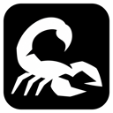

<div align="center">



# Yaare

**Build with ❤️** | [官网](https://yaare.app) · [Discord](https://discord.gg/pcpfXrGcA4) · [GitHub](https://github.com/plumbral/yaare)

</div>

Yaare 是一款基于 [MyGo](https://github.com/egoist/mygo) 构建的跨平台 SSH 客户端，支持 Windows、macOS 和 Linux。客户端集成了多标签与分屏终端、SFTP 文件管理、远程文本编辑及加密配置同步，同时支持通过 Docker 自托管，在浏览器中直接使用。

[English](README.md) · **简体中文** · [繁體中文](README.zh-Hant.md) · [日本語](README.ja.md)

## 核心特点

- **轻量桌面架构**：基于 [MyGo](https://github.com/egoist/mygo) 构建，使用 Go 后端搭配系统原生 WebView，无需打包 Electron，安装包体积与内存占用更低；支持 Windows、macOS、Linux，并提供可自托管的 Docker 浏览器版。
- **本地存储与隐私**　采用 `AGPL-3.0-only` 开源协议，无需注册账号，不收集遥测数据。桌面版用系统凭据存储加密已保存的密码和托管私钥，Docker 版使用独立卷中的实例密钥。能读取数据文件的人也能读取主机地址、用户名、备注、快捷命令，以及手动录制的终端输出。可选同步使用端到端加密，连接你指定的 Yaare 实例、WebDAV 或 S3。
- **一体化 SSH 工作台**：将终端、SFTP 文件管理、远程文本编辑、目录对比同步、端口转发与远程桌面整合在同一会话工作区，减少工具切换。

## 主要功能

| 模块 | 支持内容 |
| --- | --- |
| **终端与会话** | 多标签与分屏、工作区状态记忆、断线重连、多窗格命令广播、快捷命令、会话日志、通过 `rz` 和 `sz` 使用 ZMODEM 传输文件 |
| **连接与网络** | 主机分组与批量编辑、导入 `~/.ssh/config`、可复用身份与托管私钥、通过 SSH Agent 使用用户证书和 FIDO2 安全密钥、多级跳板机、HTTP / SOCKS5 代理、本地 / 远程 / 动态 SOCKS5 端口转发 |
| **文件与编辑** | SFTP 浏览与拖拽传输、传输队列与断点续传、SCP、可检测冲突和查看差异的内置远程文本编辑器、本地与远程目录对比及双向同步 |
| **远程桌面** | 支持全屏和只读模式的内置 VNC 客户端、SSH X11 转发、Windows 下经 SSH 通道调用系统 RDP |
| **同步与备份** | 支持 Yaare 自托管、WebDAV、S3 端到端加密同步与历史版本回滚，以及跨系统本地 `.yaare` 加密备份迁移 |
| **自托管与定制** | 单用户 Docker 浏览器版支持 SSH、SFTP 和 VNC，可与桌面端同步配置。界面提供多套明暗主题和终端配色，支持自定义快捷键及简中、繁中、英语和日语 |

## 后续计划

- [ ] **AI 终端辅助**：结合终端上下文提供命令生成、报错排查与日志分析
- [ ] **AI 自动化运维**：通过 AI 规划并自动执行多步骤排查、配置与日常运维任务，在用户确认与权限边界内减少重复手工操作
- [ ] **iOS 和 Android 移动客户端**

## 下载安装

前往 [GitHub Releases](https://github.com/plumbral/yaare/releases)，在对应版本的 **Assets** 中选择适用平台的安装包：

- **Windows**：x64 设备选择 `amd64` 版本的 `.exe`，Arm 设备选择 `arm64`，运行安装向导完成安装。
- **macOS**：支持 macOS 13.3 及以上，Apple 芯片与 Intel 机型共用同一 `.dmg`。打开后将 **Yaare** 拖入「应用程序」，复制完成后推出磁盘映像。
- **Linux**：x86-64 与 ARM64 均提供 `.deb` 和 `.rpm`。如需仅安装到当前用户目录，可将同一版本的 `install.sh` 与对应架构的 `.tar.gz` 放在同一目录，然后执行 `sh install.sh`。

> 日常开发与测试主要在 Windows 和 Linux 上进行，macOS 端目前实机验证较少，遇到问题欢迎反馈。

每个版本均附带 `SHA256SUMS`，可用于校验下载文件的完整性。

**Docker 自托管** — 将发布页中的 `compose.yaml` 下载到独立目录，执行 `docker compose run --rm yaare init` 设置管理员密码，再使用 `docker compose up -d` 启动。在本机访问 `http://127.0.0.1:4180`，使用 `admin` 登录。[Docker 部署指南](deployment/docker/README.md)

## 使用文档

- [配置同步与备份](docs/Sync_and_Backup.md)，支持自托管实例、WebDAV 和 S3
- [本地加密备份与迁移](docs/Local_Encrypted_Config.md)
- [macOS 桌面版说明](docs/macOS_Desktop.md)
- [版本发布流程](docs/releases/README.md)

## 从源码运行

需要 Go 1.27.3+ 与 Bun 1.4.4，各平台额外依赖如下：

- **Windows**：需要 Evergreen WebView2 运行时。
- **macOS**：打包通用 `.dmg` 请参阅 [macOS 桌面版说明](docs/macOS_Desktop.md)。
- **Linux**：需要 GTK 3 与 WebKitGTK 4.1 开发库；如需保存密码或私钥，需解锁 Secret Service 密钥环。

在仓库根目录执行以下命令启动桌面端开发模式：

```sh
bun install --frozen-lockfile
bun run generate
bun run dev
```

常用命令：

| 命令 | 说明 |
| --- | --- |
| `bun run dev:web` | 在 `http://127.0.0.1:5173/` 启动前端开发预览 |
| `bun run typecheck` | 检查 TypeScript 类型 |
| `bun run build` | 构建当前平台的桌面端 |
| `bun run build:web` | 构建桌面前端并打包供 MyGo 嵌入 |
| `bun run build:browser` | 构建自托管浏览器版前端 |
| `.\scripts\check.ps1` | 在 Windows 上运行前端测试、Go 测试、静态检查与编译 |

## 目录说明

- `cmd/yaare`、`cmd/yaare-web`：桌面端与自托管服务入口。
- `internal/`：Go 后端代码，详见 [后端结构](internal/README.md)。
- `frontend/src/`：React 工作台界面。
- `locales/`：英语、日语、简体中文和繁体中文的界面翻译。
- `scripts/`、`tools/`、`tests/`：构建脚本、资源生成工具与回归测试，详见 [测试说明](tests/README.md)。

修改后端接口或翻译后执行 `bun run generate`，修改配色后执行 `bun run theme:generate`。

## 许可证

Yaare 桌面客户端、浏览器客户端及 Docker 自托管服务的自有代码采用 GNU Affero General Public License v3.0，许可证标识为 `AGPL-3.0-only`。第三方代码和资源沿用各自的许可证。[项目许可证](LICENSE) · [第三方声明](resources/licenses/)
