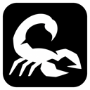

<div align="center">



# Yaare

**Build with ❤️** | [官方網站](https://yaare.app) · [Discord](https://discord.gg/pcpfXrGcA4) · [GitHub](https://github.com/plumbral/yaare)

</div>

Yaare 是一款基於 [MyGo](https://github.com/egoist/mygo) 建置的跨平台 SSH 用戶端，支援 Windows、macOS 與 Linux。用戶端整合了多分頁與分割畫面終端機、SFTP 檔案管理、遠端文字編輯及加密設定同步，同時支援透過 Docker 自行架設，於瀏覽器中直接使用。

[English](README.md) · [简体中文](README.zh-Hans.md) · **繁體中文** · [日本語](README.ja.md)

## 核心特點

- **輕量桌面架構**：基於 [MyGo](https://github.com/egoist/mygo) 建置，採用 Go 後端搭配系統原生 WebView，無須打包 Electron，安裝包體積與記憶體佔用更低；支援 Windows、macOS 與 Linux，並提供可自行架設的 Docker 瀏覽器版。
- **本機儲存與隱私**　採用 `AGPL-3.0-only` 開源授權，無須註冊帳號，不收集遙測資料。桌面版透過系統憑證儲存區加密已儲存的密碼與代管私鑰，Docker 版則使用獨立磁碟區中的執行個體金鑰。能讀取資料檔案的人也能讀取主機位址、使用者名稱、備註、快捷命令，以及手動錄製的終端機輸出。啟用同步時，資料會以端對端加密傳至你指定的 Yaare 執行個體、WebDAV 或 S3。
- **一體化 SSH 工作台**：將終端機、SFTP 檔案管理、遠端文字編輯、目錄比對同步、連接埠轉發與遠端桌面整合在同一工作階段中，減少工具切換。

## 主要功能

| 模組 | 支援項目 |
| --- | --- |
| **終端機與工作階段** | 多分頁與分割畫面、工作區狀態記憶、斷線重連、多窗格指令廣播、快捷指令、工作階段記錄、透過 `rz` 和 `sz` 使用 ZMODEM 傳輸檔案 |
| **連線與網路** | 主機分組與批次編輯、匯入 `~/.ssh/config`、可共用身分與託管私鑰、支援使用者憑證與 FIDO2 安全金鑰的 SSH Agent、多層跳板機、HTTP / SOCKS5 代理、本機 / 遠端 / 動態 SOCKS5 連接埠轉發 |
| **檔案與編輯** | SFTP 瀏覽與拖曳傳輸、傳輸佇列與斷點續傳、SCP、可偵測衝突並比對差異的內建遠端文字編輯器、本機與遠端目錄比對及雙向同步 |
| **遠端桌面** | 支援全螢幕和唯讀模式的內建 VNC 用戶端、SSH X11 轉發、Windows 下透過 SSH 通道呼叫系統 RDP |
| **同步與備份** | 支援 Yaare 自架執行個體、WebDAV、S3 端對端加密同步與歷史版本還原，以及跨系統本機 `.yaare` 加密備份移轉 |
| **自架與自訂** | 單一使用者 Docker 瀏覽器版支援 SSH、SFTP 和 VNC，可與桌面版同步設定。介面提供多款明暗主題和終端機配色，支援自訂快速鍵及簡中、繁中、英語和日語 |

## 後續規劃

- [ ] **AI 終端機輔助**：結合終端機上下文提供指令產生、錯誤排查與日誌分析
- [ ] **AI 自動化維運**：透過 AI 規劃並自動執行多步驟排查、設定與日常維運任務，在使用者確認與權限邊界內減少重複人工操作
- [ ] **iOS 和 Android 行動版**

## 下載與安裝

前往 [GitHub Releases](https://github.com/plumbral/yaare/releases)，在對應版本的 **Assets** 中選擇適用平台的安裝檔：

- **Windows**：x64 裝置選擇 `amd64` 版本的 `.exe`，Arm 裝置選擇 `arm64`，執行安裝精靈完成安裝。
- **macOS**：支援 macOS 13.3 及以上，Apple 晶片與 Intel 機型共用同一 `.dmg`。開啟後將 **Yaare** 拖入「應用程式」，拷貝完成後退出磁碟映像檔。
- **Linux**：x86-64 與 ARM64 均提供 `.deb` 與 `.rpm`。若僅需安裝至目前使用者目錄，請將同一版本的 `install.sh` 與對應架構的 `.tar.gz` 置於同一目錄，再執行 `sh install.sh`。

> 日常開發與測試主要在 Windows 與 Linux 上進行，macOS 端目前實機驗證較少，遇到問題歡迎回報。

每個版本均附帶 `SHA256SUMS`，可用於核對檔案的 SHA-256 校驗碼。

**Docker 自架** — 從發行頁下載 `compose.yaml` 至獨立目錄，執行 `docker compose run --rm yaare init` 設定管理員密碼，再以 `docker compose up -d` 啟動。於本機瀏覽器開啟 `http://127.0.0.1:4180`，使用 `admin` 登入。[Docker 部署指南](deployment/docker/README.md)

## 使用文件

- [設定同步與備份](docs/Sync_and_Backup.md)，支援自架執行個體、WebDAV 和 S3
- [本機加密備份與移轉](docs/Local_Encrypted_Config.md)
- [macOS 桌面版說明](docs/macOS_Desktop.md)
- [版本發行流程](docs/releases/README.md)

## 從原始碼啟動

需要 Go 1.27.3 以上與 Bun 1.4.4，各平台額外需求如下：

- **Windows**：需要 Evergreen WebView2 執行階段。
- **macOS**：打包通用 `.dmg` 請參閱 [macOS 桌面版說明](docs/macOS_Desktop.md)。
- **Linux**：需要 GTK 3 與 WebKitGTK 4.1 開發函式庫；如需儲存憑證，請先解鎖 Secret Service 金鑰圈。

在專案根目錄執行以下指令啟動桌面版開發環境：

```sh
bun install --frozen-lockfile
bun run generate
bun run dev
```

常用指令：

| 指令 | 說明 |
| --- | --- |
| `bun run dev:web` | 在 `http://127.0.0.1:5173/` 啟動前端開發預覽 |
| `bun run typecheck` | 檢查 TypeScript 型別 |
| `bun run build` | 建置目前平台的桌面應用程式 |
| `bun run build:web` | 建置桌面前端並封裝供 MyGo 嵌入 |
| `bun run build:browser` | 建置自架服務用的瀏覽器前端 |
| `.\scripts\check.ps1` | 在 Windows 上執行前端測試、Go 測試、靜態檢查與編譯 |

## 目錄說明

- `cmd/yaare`、`cmd/yaare-web`：桌面版與自架服務進入點。
- `internal/`：Go 後端程式碼，詳見 [後端架構](internal/README.md)。
- `frontend/src/`：React 工作區介面。
- `locales/`：英語、日語、簡體中文和繁體中文的介面翻譯檔。
- `scripts/`、`tools/`、`tests/`：建置腳本、資源產生工具與回歸測試，詳見 [測試說明](tests/README.md)。

修改後端介面或翻譯後執行 `bun run generate`，調整配色後執行 `bun run theme:generate`。

## 授權

Yaare 桌面版、瀏覽器用戶端與 Docker 自架服務的自有程式碼採用 GNU Affero General Public License v3.0，授權識別碼為 `AGPL-3.0-only`。第三方程式碼與素材依各自授權條款使用。[專案授權條款](LICENSE) · [第三方授權聲明](resources/licenses/)
